# AI Candidate Role Matcher

Upload a CV and get back the three technical jobs it fits best, with a plain explanation of why.

## Project Description

The AI Candidate Role Matcher is a small web app that reads a CV and suggests which tech jobs the person suits best. You upload your CV, and a few seconds later it shows the **top 3 matching roles**. Each one has a score and a list of the skills that led to it.

It works like the first screening step that many companies run before a human reads an application. This kind of software is called an ATS (Applicant Tracking System). Our version is **open about its reasoning**: it shows which skills it found, which roles it ruled out, and why each suggestion made the list.

Think of it like a **careers adviser with a checklist**. First they underline every skill in your CV. Then they cross out any job where you're missing the basics. Then they ask a colleague for a second opinion (the AI model). Finally, they rank what's left and tell you why.

It currently covers seven roles: Data Analyst, Data Engineer, Backend Engineer, Frontend Engineer, Full Stack Engineer, ML (Machine Learning) Engineer and DevOps Engineer. **[Try the live demo](https://ai-candidate-system-1-34hyurh2hevdqdtzqtsjgl.streamlit.app/)**

**How to read this diagram**

1. **CV Upload:** The person uploads their CV as a file.
2. **Text Extraction:** The system pulls the plain text out of the file so it can be read.
3. **Skill Extraction & Normalization:** It finds known skills in the text and merges different spellings of the same skill (for example "JS" and "JavaScript").
4. **Eligibility Gating:** Any role where the CV is missing the core skills is ruled out.
5. **ML Model:** A small AI model, trained on example CVs, gives its own opinion on which role fits.
6. **Hybrid Scoring:** The AI's opinion and the skill match are blended into one final score per role.
7. **Seniority Detection:** Separately, the system estimates whether the CV reads as junior, mid-level or senior.
8. **Top 3 Roles + Explanations:** The three highest-scoring roles are shown, each with the skills that support it.

## Why This Project Exists

**The problem.** Picture Sam, a developer with a mix of data and backend experience. Most simple job-matching tools would give Sam **one** job title and stop there. They wouldn't explain how they decided. They might even suggest a role Sam is clearly unqualified for, just because an AI model was confident.

This matters to everyone involved:

- **Candidates** don't learn which of their skills count, or which other roles they could apply for.
- **Recruiters** get a label they can't check or question.
- **Mixed or unusual profiles** often fall through the cracks, because the AI has seen few people like them.

**How this project helps.** We built it as a **decision-support tool, not a job-title predictor**. For Sam, it would:

- list every skill it recognised,
- rule out roles where Sam lacks the essentials,
- rank the remaining roles and show the top three,
- explain each one by naming the skills behind it.

The AI model is **one input, not the final judge**. The app also says clearly that hiring decisions must still involve a human.

## Thought Process & Approach

The steps below follow the order the system works in, from upload to result.

### Step 1: Reading the CV

- **What it does:** It opens the uploaded file and pulls out all the text, page by page.
- **Why we did it this way:** Everything after this step works on plain text, so we kept this step simple and reliable. We used ready-made libraries (pre-written code packages) that are built for reading PDF and Word files.
- **Trade-off:** It's fast, free and predictable. But it only reads real text, so a scanned image of a CV gives the system nothing to work with.

### Step 2: Finding and tidying up the skills

- **What it does:** It checks the CV text against a fixed list of known skills for each role, which we call the **skill registry**. It then merges different names for the same skill (for example "ReactJS" becomes "React", and "Amazon Web Services" becomes "AWS").
- **Why we did it this way:** A fixed list means every result can be traced to an exact word in the CV. Merging names stops one skill from being counted as two, or missed because of spelling.
- **Trade-off:** It's transparent and easy to check, but any skill that isn't on the list is invisible to the system.

### Step 3: Ruling out roles that don't fit (eligibility gating)

- **What it does:** Each role has a few "must-have" signals. For example, Data Analyst needs something like SQL (a language for querying databases) or a reporting tool such as Power BI or Tableau. DevOps needs cloud or container tools such as AWS, Docker or Kubernetes. If a CV has **none** of a role's signals, that role's AI score is set to zero.
- **Why we did it this way:** AI models can be confidently wrong. A simple common-sense rule catches obvious mismatches before they reach the results.
- **What we considered instead:** Letting the AI model decide alone, which is how many job-matching demos work. We didn't trust it to avoid false matches.
- **Trade-off:** There are fewer silly suggestions. But the rules are hand-written and fairly loose: one matching signal is enough to pass.

### Step 4: Asking the AI model for a second opinion

- **What it does:** A small machine learning model (software that learns patterns from examples instead of following hand-written rules) estimates how likely the CV is to belong to each role. It uses a **decision tree**, which works like a flowchart of yes/no questions such as "Does the CV mention Docker?".
- **Why we did it this way:** Decision trees are simple, quick to train and easy to inspect, which suits a small, explainable prototype. We trained it on a small set of example CVs, each labelled with its correct role.
- **Trade-off:** It's easy to understand and needs no special hardware. But with so little training data, its opinion is rough, which is why it doesn't get the final say.

### Step 5: Blending everything into one score (hybrid scoring)

- **What it does:** For each role, the system combines the AI's opinion with a **skill-overlap score** (the share of that role's key skills found in the CV).
  - If the AI gives the role some chance, the final score is **70% AI and 30% skill overlap**.
  - If the AI gives the role no chance at all, the system falls back to the skill overlap alone, at **half weight**.
- **Why we did it this way:** Neither source is reliable on its own. The fallback means a mixed or unusual profile can still surface a sensible role, even when the AI has never seen anyone like it.
- **What we considered instead:** Using the AI score alone, or the skill overlap alone.
- **Trade-off:** The results are steadier and fairer to unusual profiles. But the 70/30 and 50% weights were chosen by judgement, not measured.

### Step 6: Estimating seniority

- **What it does:** It scans the CV for words that hint at level. Words like "lead", "architect" or "designed" suggest senior. Words like "intern", "junior" or "trainee" suggest junior. It then labels the CV as Junior, Mid-level or Senior.
- **Why we did it this way:** It's a lightweight extra that adds useful context to the job suggestions without needing more data.
- **Trade-off:** It's instant and easy to understand, but it's only a rough guide.

### Step 7: Ranking and explaining the results

- **What it does:** It sorts all roles by final score and shows the top three. For each one, it lists the CV skills that support the match. It also shows a bar chart of every role's score and a skill breakdown for the top role.
- **Why we did it this way:** A ranked list with reasons is more honest and more useful than a single label. Real CVs often fit more than one role.
- **Trade-off:** The results are clearer and easier to check, but showing more information makes the screen busier.

## Tech Stack

| Tool / Technology | Why we used it |
|---|---|
| **Python** | Almost every tool below is built for it. |
| **Streamlit** | It let us build the upload page, results and charts quickly. |
| **Streamlit Community Cloud** | It runs the live demo. |
| **scikit-learn** | It provides the decision tree model and the tools to test it. |
| **joblib** | The app reuses the trained model instead of retraining it every time. |
| **pdfplumber** | It extracts the CV text from uploaded PDFs. |
| **python-docx** | It supports CVs written in Word (currently only from the command line, see Limitations). |
| **pandas** | It loads the training examples and holds the score table for each role. |
| **NumPy** | scikit-learn and pandas rely on it. |
| **regex** | Listed in the project's requirements. The skill search actually uses Python's built-in version. TODO: confirm whether it's still needed. |

## Limitations

- **Very small training data.** The AI model learned from only 14 example CVs, two per role. It scored 75% when tested on just 4 examples. *In practice:* its opinion is a rough guess, not a reliable prediction.
- **The AI step isn't working as intended right now.** The model learned skill names with capital letters ("Python"), but the app passes them in lower case ("python"). So the model doesn't recognise any skills, and it rates every CV as 100% Data Analyst. *In practice:* Data Analyst is pushed up whenever a CV passes its eligibility check. Every other role is ranked only by the skill-overlap fallback.
- **Repeated skills don't count extra yet.** The design is to give more weight to skills mentioned several times, but the skill finder returns each skill only once. *In practice:* a skill mentioned ten times counts the same as one mentioned once.
- **Fixed, short skill list.** Only around 35 skills across 7 roles are recognised, and only a few alternative spellings are merged. *In practice:* skills that aren't on the list (for example Go, Azure or Spark) are ignored, and roles outside the seven aren't considered.
- **Some eligibility signals can never be found.** A few must-have words, such as "api", "backend", "spark" or "azure", aren't in the skill list, so the system can never detect them. *In practice:* some CVs may be ruled out of a role they actually fit.
- **Ruled-out roles can still appear.** Gating sets a role's AI score to zero, but the skill-overlap fallback can still give it a small score. *In practice:* a role marked as ineligible may still show up in the top three when few roles fit.
- **Rough seniority check.** It looks for words inside other words, so "known" counts as "own" (a senior signal) and "assistant" counts as "assist" (a junior signal). It doesn't look at years of experience. *In practice:* the seniority label can be wrong and should be treated as a hint only.
- **The web app only accepts PDFs.** The code underneath can read Word files, but the upload button only allows PDF. *In practice:* Word users have to convert their CV first.
- **Text-based files only.** Scanned or image-only PDFs contain no readable text.
- **Hand-picked weights and rules.** The 70/30 blend, the 50% fallback and the eligibility rules come from judgement, not testing against real hiring outcomes. *In practice:* treat scores as a comparison between roles, not as an absolute measure of fit.
- **Not a hiring tool on its own.** This is a prototype. *In practice:* any real hiring decision needs human review.

## Future Improvements

**Short term**

- **Fix the capital letters bug in the AI step.** Use lower-case skill names when training the model, then retrain it. *Benefit:* the AI's opinion will actually reflect the CV, and Data Analyst will stop being pushed up for everyone.
- **Make repeated skills count.** Count how often each skill appears instead of just whether it appears. *Benefit:* real, repeated experience will stand out from a one-off mention.
- **Allow Word uploads in the web app.** *Benefit:* candidates can upload a .docx file directly.
- **Fully exclude ineligible roles.** Remove them from the ranking completely, rather than only zeroing their AI score. *Benefit:* the top three will only ever contain roles the CV qualifies for.
- **Match the eligibility rules to the skill list.** Add the missing signals to the skill registry, or update the rules. *Benefit:* fewer roles wrongly ruled out.
- **Match whole words in the seniority check.** *Benefit:* fewer false junior or senior labels.

**Long term**

- **Bigger and more realistic training data.** *Benefit:* a more trustworthy AI opinion, with test results that mean something.
- **A larger, easier-to-update skill list with more spellings.** *Benefit:* more of each CV is recognised, and new roles can be added easily.
- **Use the skill-category weights we've drafted.** The project has a draft file (`src/role_weights.py`) that says which kinds of skills matter most for each role. It isn't connected to the app yet. TODO: confirm plans. *Benefit:* scores that reflect what matters most for each job.
- **Test and tune the scoring weights.** Measure the 70/30 blend and the fallback against labelled examples. *Benefit:* evidence-based scores instead of hand-picked ones.
- **Read scanned CVs.** Add OCR (optical character recognition, software that reads text from images). *Benefit:* image-based CVs can be analysed too.
- **Estimate seniority from dates in the CV.** *Benefit:* a more accurate experience level.
